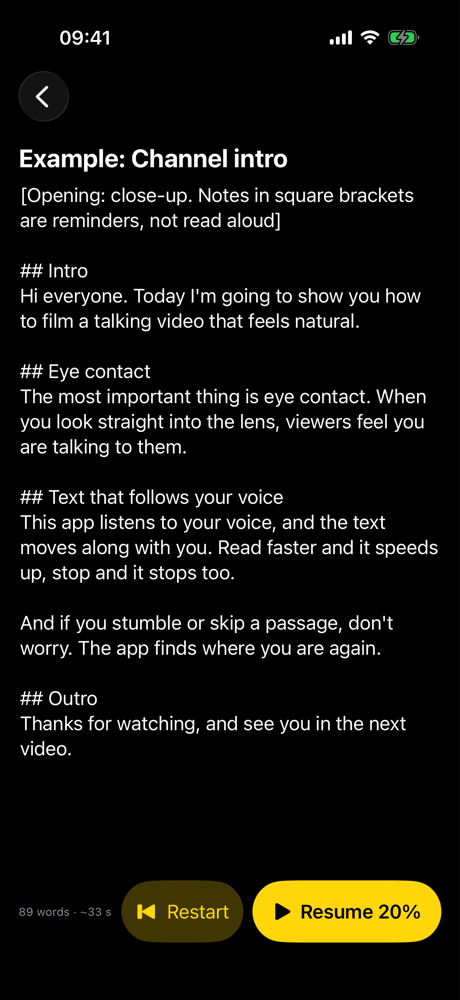
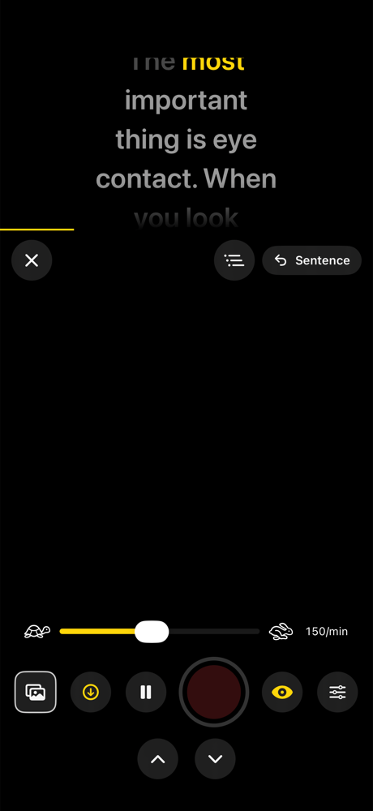
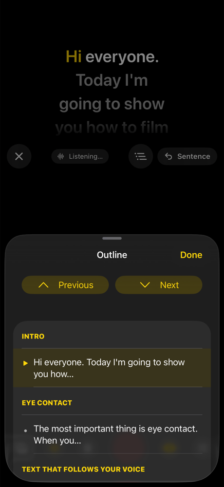
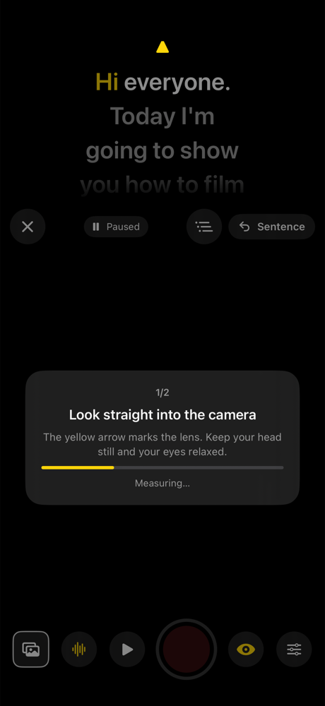
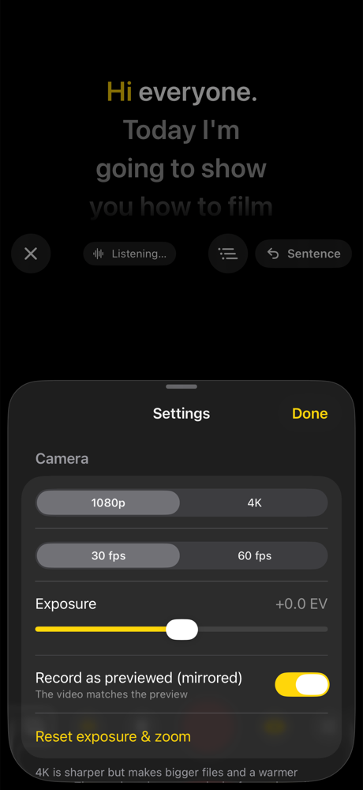

# EyePrompter

An iPhone teleprompter that scrolls along with your voice and corrects your gaze so you appear to look straight into the camera.

<p align="center">
  
  
  
  
  
</p>

<p align="center"><sub>Script editor · Prompter · Outline · Gaze calibration · Camera settings</sub></p>

## Features

- **Voice-following scroll**: on-device speech recognition (SFSpeechRecognizer, Vietnamese by default, other languages selectable) is matched word by word against the script. The app estimates your reading pace in words per minute, so scrolling stays smooth and keeps up when you read fast.
- **Re-reading**: re-read a sentence and the text moves back to it. You can also tap "↺ Câu" to return to the start of the sentence, drag the text to pick a line, or jump by paragraph or heading from the outline.
- **Resume**: reopen the app and it continues where you stopped.
- **Eye-contact correction**: Vision finds the eyes and a Metal shader shifts the iris so you appear to look at the camera. Calibrating takes 4 seconds: look at the camera for 2 s, then at the text for 2 s.
- **Recording**: front camera at 1080p or 4K, 30 or 60 fps, with exposure, zoom and an optional mirrored output. Clips are saved to Photos. Portrait and landscape are both supported.
- **English and Vietnamese**: switch the interface language from the globe button on the Scripts screen, or leave it on the device language. The speech-recognition language is set separately in Settings, so you can read a Vietnamese script with an English interface.
- **Script import**: paste from a Mac through Universal Clipboard, AirDrop a `.txt`, `.md` or `.rtf` file, or use "Open in".

## Script format

```text
# Video title

## Intro
Hi everyone. Short sentences, written exactly as you say them.

[B-roll: a note that is not read aloud, on its own line]

## Part 1
Paragraphs of 1 to 3 sentences, separated by a blank line.
```

- `# Title`: the script's name in the app.
- `## Section`: listed in the outline; the app does not wait for you to read it.
- `[note]`: shown dimmed; skipped by voice tracking.

The repo also includes two tools for preparing scripts:

- In the app, **+ › Script conversion prompt (AI)** gives you a prompt, in the interface language, to paste into any AI chat to convert a script into this format. `PROMPT-chuyen-kich-ban.md` is the Vietnamese version as a file.
- `skills/eyeprompter-script/`: a skill for Claude Code, Antigravity or Gemini CLI that writes or converts scripts. It comes with a checker, `scripts/check_script.py`. To install it, copy the folder into `~/.claude/skills/`.

## Build

Requirements: Xcode 16 or later, iOS 17 or later.

1. Open `EyePrompter.xcodeproj`.
2. Under *Signing & Capabilities*, select your own Team and change the Bundle Identifier.
3. Run it on a real iPhone. The Simulator has no front camera, so recording and gaze correction can't be tested there.
